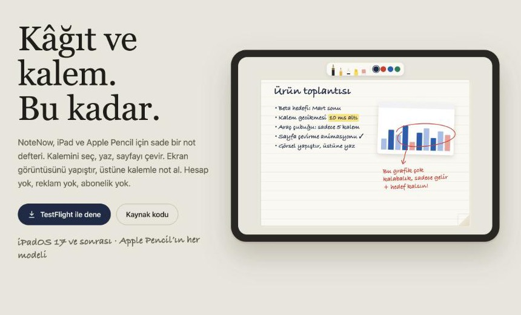

<div align="center">

# NoteNow

**Paper and pen for the iPad. That's it.**<br>
A free, quiet notebook for Apple Pencil: five pens, real page turns,<br>
and screenshots you can paste and mark up on the spot. No account, no ads, no subscription.

<br>

[](#getting-started)
[](#under-the-hood)
[](#apple-pencil-first)
[](#privacy-you-can-verify)
[](https://notenow-app.netlify.app/destek/#testflight)

[Website](https://notenow-app.netlify.app/) · [Privacy](https://notenow-app.netlify.app/gizlilik/) · [Support](https://notenow-app.netlify.app/destek/)

</div>

<br>

## Contents

- [Why](#why)
- [What's in the notebook](#whats-in-the-notebook)
- [Apple Pencil first](#apple-pencil-first)
- [Under the hood](#under-the-hood)
- [Repository layout](#repository-layout)
- [Getting started](#getting-started)
- [Privacy you can verify](#privacy-you-can-verify)
- [License](#license)

## Why

Note apps on the App Store are either paid or crowded with tools. NoteNow is the opposite: a notebook with a pen tray, a page and a page number. When the page is full, you turn it.

## What's in the notebook

| | |
| --- | --- |
| **Five pens** | Fountain pen, pencil, felt tip, highlighter and eraser, standing in a tray. The active pen lifts out. Tap it again for three widths and eight colours; the highlighter has its own four. The eraser removes part of a stroke or the whole line. |
| **Real page turns** | Pages are a `UIPageViewController` with the `pageCurl` style: grab the edge with a finger and the sheet curls over like paper. The ‹ › buttons turn it too, and **+** on the last page starts a new one. |
| **Notepad or open book** | Hold the iPad upright and a portrait notebook is a single page, like a notepad. Turn it sideways and it opens into a two-page spread, curling a whole leaf at a time. |
| **Paste, then write** | Paste a screenshot, pick from Photos or drag an image in from another app. Move it with one finger, pinch to resize, twist to rotate (it snaps to straight angles), or pull a corner handle. A small menu brings it to front, copies or deletes it. Ink always sits on top, so you can circle and annotate right away. |
| **Four papers** | Ruled, grid, dotted or blank, per page. Notebooks are portrait by default, like a notepad; landscape is one tap away. |
| **Library** | Cloth-bound covers in six colours. Long-press to rename, recolour or delete. |
| **Pages sheet** | Tap the page number for thumbnails of every page: jump, insert, delete, or change the current page's paper. |

The design language is "Kâğıt & Mürekkep" (paper and ink): cream ruled paper `#FBF8F1` on a warm desk `#E9E5DC`, navy ink `#1F2A44`, serif titles. The tokens live in [`NoteNow/Design/Theme.swift`](NoteNow/Design/Theme.swift) and [`site/assets/notenow.css`](site/assets/notenow.css).

## Apple Pencil first

- **The Pencil writes, fingers handle the page.** The canvas runs with `drawingPolicy = .pencilOnly`. A finger turns pages and moves images; a resting palm leaves no marks. The page-curl gestures only accept direct touches, so the Pencil never turns a page by accident.
- **Low latency.** Ink is native PencilKit (`PKInkingTool` with `.fountainPen`, `.pencil`, `.monoline` and `.marker`), with pressure and tilt.
- **Double-tap and squeeze.** `UIPencilInteraction` follows the system preference: switch to the eraser, back to the previous pen, or open the pen's colour and width panel. Pencil Pro's squeeze uses the same preference.
- **Pinch to zoom.** Two fingers zoom up to 5× and pan around the page; one finger turns the page only when the page is at full view.
- **Crisp at any size.** Each page has a fixed logical size (1000 × 1400 points portrait, 1400 × 1000 landscape) and the canvas uses PencilKit's own zoom, so strokes are rendered natively at every scale and stay put when the iPad rotates.
- **Undo per page.** Every page has its own undo history.

## Under the hood

| | |
| --- | --- |
| Language and UI | Swift, SwiftUI for the library and chrome, UIKit for the page |
| Ink | PencilKit |
| Pages | `UIPageViewController` (`.pageCurl`), one `PageViewController` per sheet |
| Storage | Plain files in the app's Documents folder: `library.json`, `pages.json` per notebook, one `.drawing` (`PKDrawing.dataRepresentation()`) per page, images as JPEG or PNG |
| Saving | Debounced writes on a background queue, flushed when the app goes to the background |
| Project | [XcodeGen](https://github.com/yonaskolb/XcodeGen) ([`project.yml`](project.yml)) |
| Dependencies | none |

## Repository layout

```text
notenow/
├── NoteNow/
│   ├── App/        app entry point
│   ├── Design/     colours, palettes, type
│   ├── Model/      notebooks, pages, images, on-disk storage
│   ├── Library/    notebook shelf and the new-notebook sheet
│   └── Editor/     page curl, PencilKit page, pen tray, pen settings, pages sheet
├── site/           notenow-app.netlify.app, static and dependency-free
├── Config/         App Store Connect export options
└── project.yml     XcodeGen project
```

## Getting started

Requirements: macOS with Xcode 27 and XcodeGen.

```bash
xcodegen generate
open NoteNow.xcodeproj
```

Pick your team under Signing & Capabilities and run on an iPad. A TestFlight build is archived and uploaded with:

```bash
xcodebuild -project NoteNow.xcodeproj -scheme NoteNow -configuration Release \
  -destination 'generic/platform=iOS' -archivePath build/NoteNow.xcarchive \
  -allowProvisioningUpdates archive
xcodebuild -exportArchive -archivePath build/NoteNow.xcarchive \
  -exportOptionsPlist Config/ExportOptions-AppStore.plist -exportPath build/export \
  -allowProvisioningUpdates
```

The website is plain HTML and CSS: open `site/index.html`, or serve the folder with `python3 -m http.server --directory site`.

## Privacy you can verify

NoteNow has no account, no analytics, no ads and no crash-reporting SDK, and it never opens a network connection. Notes stay in the app's folder on the iPad and are included in the device's own iCloud backup if that is on. Photos come through the system picker, so the app only sees the photo you choose; the pasteboard is read only when you tap "Paste".

Check it yourself:

```bash
# No networking APIs anywhere in the source.
grep -rnE "URLSession|NWConnection|URLRequest|CFSocket" NoteNow/ || echo "no network code"
```

## License

© 2026 Artun Düzay. All rights reserved. The source is published so it can be read and audited; see [`LICENSE`](LICENSE).

<div align="center">
<br>
<sub>Paper and ink · <a href="https://notenow-app.netlify.app/">notenow-app.netlify.app</a></sub>
</div>
